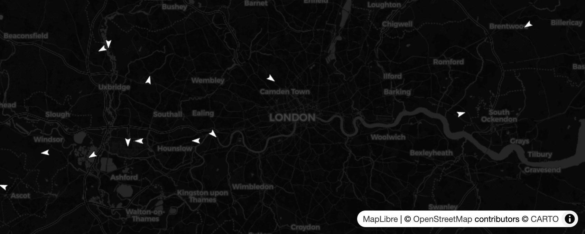

# Skyrail

A dark, full-bleed map that shows live plane (and eventually train) movement over London and beyond — with a spotter's toolkit for watchlists and a personal log. Built as a "living window" you can leave open on a second monitor.



## Status

**M1 — Planes over London: shipped.** Live plane positions from OpenSky, dead-reckoned smoothly between 10-second polls, click to see a detail card. Works locally end-to-end via a Vite dev proxy.

Tagged as [`m1`](https://github.com/amyanger/skyrail/releases/tag/m1).

Roadmap:
- M2 — Spotter log + watchlists with browser-notification alerts
- M3 — Aircraft enrichment (type codex + Wikipedia blurbs)
- M4 — London trains layer (TfL)
- M5 — European trains layer (transport.rest)
- M6 — Polish + deploy

## Quick start

Requires Node 18+.

```bash
npm install
npm run dev
```

Then open [http://localhost:5173](http://localhost:5173) **in Safari** — planes appear over London within ~10 seconds. Click any triangle for a detail card.

Other useful scripts:

```bash
npm test          # vitest — 18 tests
npm run typecheck # tsc --noEmit
npm run build     # production bundle
```

## Architecture

- **Vite + React + TypeScript** — static SPA.
- **MapLibre GL JS** — WebGL map on CARTO dark raster tiles.
- **Zustand** — in-memory plane store.
- **OpenSky Network** — `/states/all` polled every 10s with a viewport bounding box. Positions animate between polls via a `requestAnimationFrame` loop that dead-reckons from each plane's heading and velocity.
- **Vite dev proxy** — `/api/opensky/*` → `https://opensky-network.org/api/*`. OpenSky currently returns a CORS header that blocks browser clients; the proxy is a dev-time workaround. A Cloudflare Pages Function or Worker will replace it for production in M6.

See [design doc](docs/superpowers/specs/2026-04-18-skyrail-design.md) and [M1 plan](docs/superpowers/plans/2026-04-18-skyrail-m1-planes-over-london.md) for detail.

## Project layout

```
src/
  App.tsx                   # composes map + layers + polling + detail card
  config.ts                 # OpenSky URL, poll interval, home location
  map/
    Map.tsx                 # MapLibre wrapper (publishes viewport bbox)
    style.ts                # dark raster style spec
  planes/
    types.ts                # PlaneState
    opensky.ts              # fetch client with AbortSignal
    store.ts                # Zustand store keyed by icao24
    usePlanePolling.ts      # polling hook with in-flight cancellation
    deadReckon.ts           # equirectangular position extrapolation
    PlaneLayer.tsx          # GeoJSON source + RAF render loop
    PlaneDetailCard.tsx     # selected-plane UI
  util/
    bbox.ts                 # viewport → OpenSky bbox

tests/
  util/bbox.test.ts
  planes/{opensky,store,deadReckon}.test.ts
```

## Data sources

- Aircraft positions: [OpenSky Network](https://opensky-network.org)
- Basemap tiles: [CARTO Dark](https://carto.com/attribution/) on [OpenStreetMap](https://www.openstreetmap.org/copyright) data

## License

MIT
